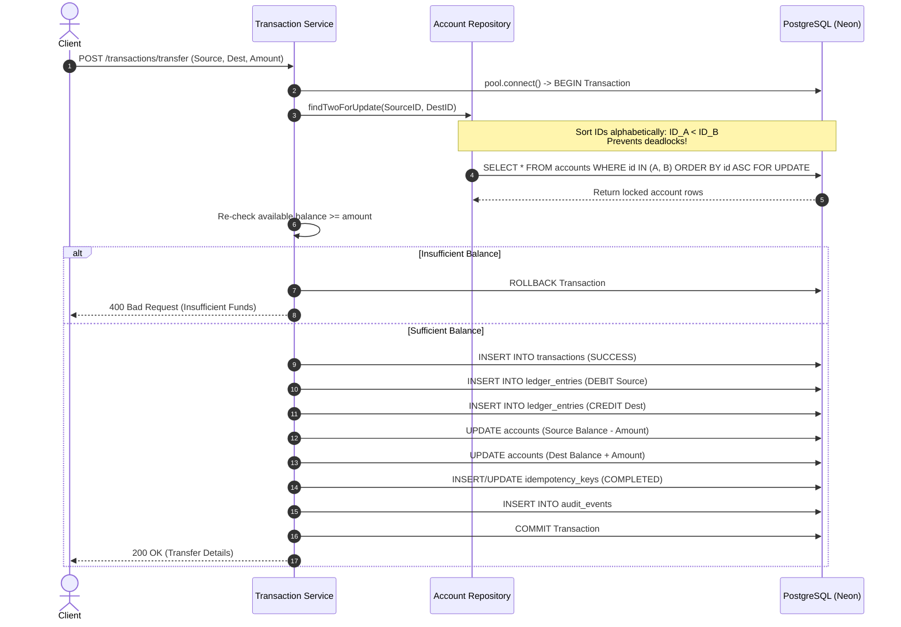

# LedgerLine: Backend Architecture & Financial Core Design

## 1. System Overview

**LedgerLine** is an enterprise-grade financial backend designed for secure money movement, double-entry bookkeeping, and auditable ledger management. Developed for the Snovasys Fresher Hiring Challenge 2026, LedgerLine prioritizes financial correctness, strict concurrency safety, idempotency, and auditability above all else.

---

## 2. Fundamental Financial Invariants

The architecture enforces seven non-negotiable financial invariants across application code and database constraints:

1. **Double-Entry Balance Equality**: Every successful internal transfer produces balanced debit and credit entries of identical amount (`Debit Amount == Credit Amount`).
2. **Internal Transfer Zero-Sum**: Internal transfers move funds between accounts without altering the aggregate system balance.
3. **Conservation of Money**: External deposits and withdrawals are the *only* operations that modify the total money supply in the system.
4. **Non-Negative Balance Constraint**: No account can have a negative balance under any circumstance (`balance >= 0` enforced by PostgreSQL check constraint and post-lock balance validations).
5. **Atomicity of Postings**: A financial transaction, its corresponding ledger entries, account balance updates, audit events, and idempotency states are committed atomically in a single PostgreSQL transaction (`BEGIN ... COMMIT`).
6. **No Partial Postings on Failure**: Any failure during transaction execution triggers an immediate `ROLLBACK`, leaving zero partial or phantom records.
7. **Immutable Financial History**: Ledger entries are strictly append-only. Financial history is never updated or deleted. Corrections must take the form of explicit compensating transactions.

---

## 3. Technology Stack & Rationale

- **Runtime**: Node.js (LTS) — Asynchronous I/O for scalable request processing.
- **Framework**: Express.js — Lightweight, unopinionated modular HTTP server.
- **Language**: JavaScript (ES Modules) — Clean, standard, native modern JavaScript.
- **Database**: PostgreSQL (hosted on Neon) — ACID compliance, row-level locking, and strict relational integrity.
- **Database Driver**: `pg` (node-postgres) — Direct raw parameterized SQL queries with zero ORM abstraction overhead.
- **Authentication**: JWT & bcrypt (12 salt rounds) — Stateless, role-based authorization.
- **Validation**: Zod — Strict schema validation for headers, query params, and request bodies.
- **Testing**: Jest + Supertest — Comprehensive unit, integration, and concurrency test suites against real PostgreSQL.
- **API Documentation**: OpenAPI / Swagger UI — Interactive documentation at `/api-docs`.
- **Structured Logging**: Pino — High-performance JSON logger with credential and header redaction.

---

## 4. Layered Architecture

```
Client Requests
      │
      ▼
Middleware (Helmet, CORS, RateLimiter, RequestLogger)
      │
      ▼
Authentication & Authorization (authenticate.js, authorize.js)
      │
      ▼
Validation Layer (Zod Schemas)
      │
      ▼
Controllers (HTTP Handling, ApiResponse formatting)
      │
      ▼
Services (Business Logic, Idempotency, Invariant Verification)
      │
      ▼
Repositories (Raw Parameterized SQL, Atomic Client Transactions)
      │
      ▼
PostgreSQL Database (Neon)
```

### Module Breakdown
- `auth`: User registration, credential verification, JWT issuance, and login audit tracking.
- `users`: User entity management.
- `accounts`: Bank account lifecycle, balance lookups, and account-level access controls.
- `transactions`: Core money movement engine (deposits, withdrawals, transfers).
- `ledger`: Append-only double-entry ledger queries and balance reconciliation.
- `statements`: Running balance calculations, date filtering, and refused attempt auditing.
- `audit`: Immutable audit trail for compliance and forensic review.
- `admin`: Administrative user and account status lifecycle management.

---

## 5. Concurrency & Locking Strategy

To prevent race conditions, double-spending, and deadlocks under heavy concurrent load, LedgerLine implements a rigorous row-level locking strategy:



### Deadlock Elimination
When two accounts transfer money to each other simultaneously, arbitrary locking order creates circular wait states. LedgerLine sorts account UUIDs prior to issuing the query:
```sql
SELECT * FROM accounts 
WHERE id = ANY($1::uuid[]) 
ORDER BY id ASC 
FOR UPDATE;
```
Because both threads lock rows in the identical order, deadlocks (`40P01`) are mathematically eliminated.

---

## 6. Idempotency Architecture

Every money-moving request (`/deposit`, `/withdraw`, `/transfer`) supports an `Idempotency-Key` header:

1. **Request Hashing**: A SHA-256 hash is computed over `{ operation, payload }`.
2. **Conflict Detection**:
   - If the same key is submitted with the *exact same payload*, the server immediately returns the cached original result.
   - If the same key is submitted with a *different payload*, the server aborts with `409 Conflict`.
3. **Database Uniqueness**: The `idempotency_keys` table enforces `UNIQUE (user_id, idempotency_key)`.
4. **Atomic Commitment**: The idempotency status and response payload are committed in the same database transaction as the financial ledger entries.

