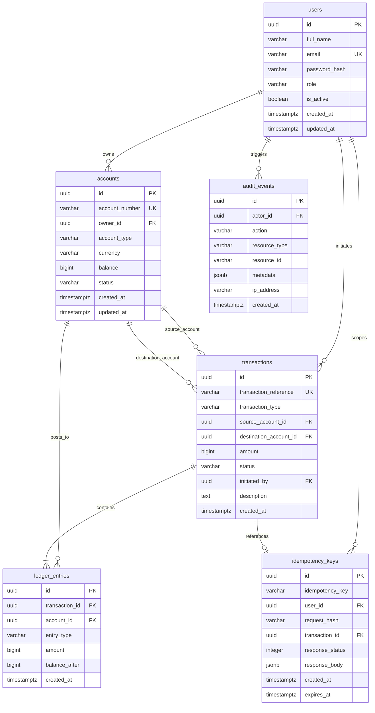

# LedgerLine: Database Design & Schema Specification

This document details the relational database design, entity relationships, integrity constraints, and indexing strategy for LedgerLine, hosted on PostgreSQL (Neon).

---

## 1. Schema Entity Relationship Diagram



---

## 2. Table Specifications & Constraints

### 1. `users`
- `id`: `UUID PRIMARY KEY DEFAULT gen_random_uuid()`
- `full_name`: `VARCHAR(255) NOT NULL`
- `email`: `VARCHAR(255) UNIQUE NOT NULL`
- `password_hash`: `VARCHAR(255) NOT NULL`
- `role`: `VARCHAR(50) NOT NULL CHECK (role IN ('ADMIN', 'ACCOUNT_HOLDER', 'AUDITOR'))`
- `is_active`: `BOOLEAN NOT NULL DEFAULT true`
- `created_at`, `updated_at`: `TIMESTAMPTZ NOT NULL DEFAULT NOW()`

### 2. `accounts`
- `id`: `UUID PRIMARY KEY DEFAULT gen_random_uuid()`
- `account_number`: `VARCHAR(64) UNIQUE NOT NULL`
- `owner_id`: `UUID NOT NULL REFERENCES users(id) ON DELETE RESTRICT`
- `account_type`: `VARCHAR(50) NOT NULL CHECK (account_type IN ('SAVINGS', 'CHECKING', 'OPERATIONAL'))`
- `currency`: `VARCHAR(3) NOT NULL DEFAULT 'INR'`
- `balance`: `BIGINT NOT NULL DEFAULT 0 CHECK (balance >= 0)` (Enforces Invariant: Negative balances impossible)
- `status`: `VARCHAR(50) NOT NULL CHECK (status IN ('ACTIVE', 'FROZEN', 'CLOSED'))`
- `created_at`, `updated_at`: `TIMESTAMPTZ NOT NULL DEFAULT NOW()`

### 3. `transactions`
- `id`: `UUID PRIMARY KEY DEFAULT gen_random_uuid()`
- `transaction_reference`: `VARCHAR(128) UNIQUE NOT NULL`
- `transaction_type`: `VARCHAR(50) NOT NULL CHECK (transaction_type IN ('DEPOSIT', 'WITHDRAWAL', 'TRANSFER'))`
- `source_account_id`: `UUID REFERENCES accounts(id) ON DELETE RESTRICT`
- `destination_account_id`: `UUID REFERENCES accounts(id) ON DELETE RESTRICT`
- `amount`: `BIGINT NOT NULL CHECK (amount > 0)`
- `status`: `VARCHAR(50) NOT NULL CHECK (status IN ('PENDING', 'SUCCESS', 'FAILED', 'REFUSED'))`
- `initiated_by`: `UUID NOT NULL REFERENCES users(id) ON DELETE RESTRICT`
- `description`: `TEXT`
- `created_at`: `TIMESTAMPTZ NOT NULL DEFAULT NOW()`
- **Consistency Constraint**:
  ```sql
  CONSTRAINT chk_transaction_accounts CHECK (
      (transaction_type = 'DEPOSIT' AND destination_account_id IS NOT NULL) OR
      (transaction_type = 'WITHDRAWAL' AND source_account_id IS NOT NULL) OR
      (transaction_type = 'TRANSFER' AND source_account_id IS NOT NULL AND destination_account_id IS NOT NULL AND source_account_id <> destination_account_id)
  )
  ```

### 4. `ledger_entries`
- `id`: `UUID PRIMARY KEY DEFAULT gen_random_uuid()`
- `transaction_id`: `UUID NOT NULL REFERENCES transactions(id) ON DELETE RESTRICT`
- `account_id`: `UUID NOT NULL REFERENCES accounts(id) ON DELETE RESTRICT`
- `entry_type`: `VARCHAR(10) NOT NULL CHECK (entry_type IN ('DEBIT', 'CREDIT'))`
- `amount`: `BIGINT NOT NULL CHECK (amount > 0)`
- `balance_after`: `BIGINT NOT NULL CHECK (balance_after >= 0)`
- `created_at`: `TIMESTAMPTZ NOT NULL DEFAULT NOW()`

### 5. `idempotency_keys`
- `id`: `UUID PRIMARY KEY DEFAULT gen_random_uuid()`
- `idempotency_key`: `VARCHAR(255) NOT NULL`
- `user_id`: `UUID NOT NULL REFERENCES users(id) ON DELETE CASCADE`
- `request_hash`: `VARCHAR(64) NOT NULL`
- `transaction_id`: `UUID REFERENCES transactions(id) ON DELETE SET NULL`
- `response_status`: `INTEGER`
- `response_body`: `JSONB`
- `created_at`: `TIMESTAMPTZ NOT NULL DEFAULT NOW()`
- `expires_at`: `TIMESTAMPTZ NOT NULL`
- **Constraint**: `CONSTRAINT uq_user_idempotency_key UNIQUE (user_id, idempotency_key)`

### 6. `audit_events`
- `id`: `UUID PRIMARY KEY DEFAULT gen_random_uuid()`
- `actor_id`: `UUID REFERENCES users(id) ON DELETE SET NULL`
- `action`: `VARCHAR(100) NOT NULL`
- `resource_type`: `VARCHAR(100) NOT NULL`
- `resource_id`: `VARCHAR(255)`
- `metadata`: `JSONB`
- `ip_address`: `VARCHAR(45)`
- `created_at`: `TIMESTAMPTZ NOT NULL DEFAULT NOW()`

---

## 3. Money Representation: Minor Units (Paise)

To prevent IEEE 754 floating-point precision loss, all monetary values are represented as integer minor units:
- Currency: Indian Rupee (INR)
- 1 Rupee = 100 Paise
- Database Column Type: `BIGINT` (supports up to 9 quintillion paise = ₹90,000,000,000,000,000)
- Application Runtime Type: JavaScript native `BigInt`
- JSON Serialization: Stringified integers (`"balancePaise": "500000"`) paired with formatted human-readable representations (`"balanceFormatted": "5000.00"`).

